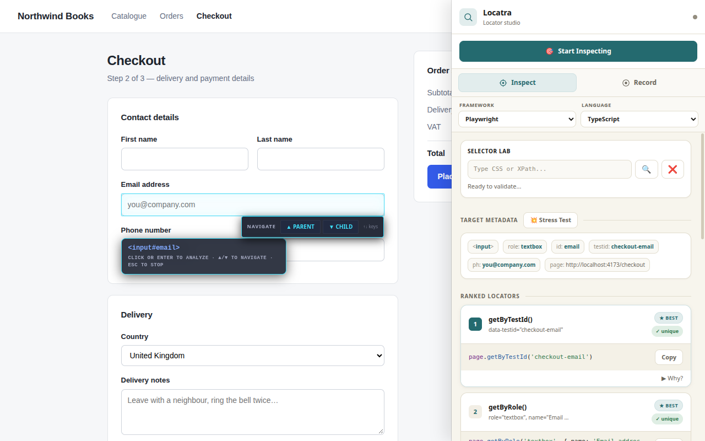

# Locatra — locator inspector & test recorder

[](https://chromewebstore.google.com/detail/locatorlens-%E2%80%93-smart-locat/amnagildbdfgfcjijilomhelgdbpgmeb)


[](https://opensource.org/licenses/MIT)

**Locatra** is a browser extension for end-to-end test authoring: inspect any element to get **ranked, uniqueness-checked locators**, validate selectors, and **record a flow into a runnable test** — all from the side panel. Output targets **Playwright, Selenium, Cypress or WebdriverIO** in **TypeScript, JavaScript, Python, Java or C#** — 14 framework × language combinations, each run for real in CI.

Extension version is defined in `manifest.json` (currently **1.3.0**) and kept in step
with `package.json` and both browser manifests by `node scripts/version.mjs`.

---

## Key features

### Frameworks & languages

- Pick a **framework** and **language** from the side-panel bar (or set the default on the Settings page) — inspector cards and recorder output update instantly:

  | Framework   | Languages                                    |
  | ----------- | -------------------------------------------- |
  | Playwright  | TypeScript · JavaScript · Python · Java · C# |
  | Selenium    | TypeScript · JavaScript · Python · Java · C# |
  | Cypress     | TypeScript · JavaScript                      |
  | WebdriverIO | TypeScript · JavaScript                      |

- Translation lives in `codegen.js`, a pure module shared by the inspector, the recorder, and the right-click “Copy Best Locator”. Java, C# and WebdriverIO are plug-in modules (`codegen-java.js`, `codegen-csharp.js`, `codegen-wdio.js`) registered through `LLCodegen.registerTarget()`.

### Inspector and ranked locators

- Semantic-first ranking (`getByTestId`, `getByRole`, `getByLabel`, …) via `content-locator-engine.js`.
- **Live uniqueness:** every card shows whether the locator matches **exactly one** element (✓ unique) or **several** (⚠ N matches), checked against the real page.
- Stability hints, accessibility notes, and a “why this locator” explanation per card.

### Shadow DOM–aware picking

- Coordinate-based deep hit testing so targets inside **open shadow roots** can be inspected and described.

### Iframe-aware locators

- Elements inside iframes can be inspected and recorded, and the generated code
  **enters the frame first** — `page.frameLocator(...)` for Playwright, a
  `switchTo().frame(...)` / `switch_to.default_content()` pair around the action for
  Selenium, and `contentDocument` traversal for Cypress. Nested frames compose.
- The content script is injected into sub-frames only when Inspect or Record is
  switched on, so ordinary browsing pays nothing for it.
- A cross-origin frame's `<iframe>` element cannot be read from inside the frame, so
  those are addressed by position and the panel says so.

### DOM traversal while inspecting

- **Arrow Up / Down** to move between parent and child elements; **Escape** to stop.

### Selector lab

- Type a **CSS selector**, an **XPath**, or a **full Playwright locator** in the side panel to **highlight matches** on the active page (with counts and errors surfaced in the UI). The first match is scrolled into view, and the status line names the method that resolved it (e.g. _“via getByRole()”_).
- **Playwright locators are resolved live against the DOM** — paste a generated line verbatim, including `await`, the `page.` handle, and a trailing action, and the Lab strips the boilerplate and highlights the target:
  ```js
  await page.getByRole('textbox', { name: 'Username or Email' }).fill('your value');
  ```
  Supported: `getByRole` (with `name` / `exact`), `getByLabel`, `getByPlaceholder`, `getByText`, `getByTestId`, `getByTitle`, `getByAltText`, and `locator('css' | '//xpath')` — plus chained scoping (`a.locator(b)`), positional reducers (`.first()` / `.last()` / `.nth(n)`), and `.filter({ hasText })`.

### Stress test

- Pick an element, then click **💥 Stress Test** to check whether it stays **locatable without its `id`/`class`** — i.e. whether its semantic role + accessible name uniquely identify it on the page. The result names what was tested (tag · role · name) and reports **Yes ✅ / No ❌**.
- Operates on the **element you picked** (it persists after you stop inspecting), guides you when nothing is selected, and reports clearly when a page can’t be reached (e.g. `chrome://`, the Web Store, PDFs).

### Recorder (side panel)

- Captures clicks, typing (debounced fills), selects, key presses, file **uploads** (`setInputFiles`), **hovers** (Alt+click), and **assertions** (visible / has-text / has-value / enabled / checked).
- **Secrets stay out of tests:** password and one-time-code fields are recorded without their value — the generated script reads `process.env.LOCATRA_PASSWORD` / `LOCATRA_SECRET` (or the framework's equivalent) instead — and secret-looking URL parameters (`password`, `token`, `api_key`, …) are written as `REDACTED`.
- **Pause/resume**, **undo/redo**, a **filterable, collapsible timeline**, and recording that **survives full-page navigation**.
- Produces an editable, **syntax-highlighted** test script in your chosen framework + language; copy or download.
- **Replay** the recording in the current tab, step by step, with a pass/fail badge per step (stop at first failure, optional slow motion); password steps ask for their value for that run only.
- **Automatic assertion suggestions:** when the URL changes or a confirmation message appears after a submit, a suggested check (`toHaveURL`, `toContainText`) appears in the timeline — nothing reaches the test until you accept it.
- **Step screenshots:** each step gets a thumbnail in the timeline, kept locally in IndexedDB (switch off in the Record tab's Settings).
- **Page Object export:** pick a region (or the whole page) and get a page-object class with named, uniqueness-checked locators and helper methods for every framework and language.
- **Test-data variables:** typed values become named variables in one `testData` declaration (`TEST_DATA` in Python and Java, `TestData` in C#); rename or edit them in the **Test data** section, or download them as `test-data.json`.

### Locator health check

- **☆ Watch** a locator from its card (or **Watch all** from a Page Object scan); the **Health** tab re-checks watched locators on the page and marks each **ok**, **broken**, **ambiguous** or **frame missing**.
- A broken locator gets a **suggested replacement**, found by matching the element's saved description (test id, id, name, label, text, …); one click applies it.
- Watched locators are kept per page, can be exported/imported as JSON, and can be re-checked automatically when you open a watched page.

### Settings page

- Open it from the popup's **⚙ Settings**, the panel's ⚙ button, or the browser's extension options.
- **Custom test-id attributes** (such as `data-qa`) in priority order, default framework and language, secret variable names, recorder toggles, health auto-check, keyboard shortcuts, and export / import / reset of settings and stored data.

### Keyboard shortcuts

| Shortcut      | Does                     |
| ------------- | ------------------------ |
| `Alt+Shift+E` | start or stop inspecting |
| `Alt+Shift+K` | start or stop recording  |

They act on the active tab of the focused window (Inspect also opens the panel), and
a page Locatra can't run on flashes a **!** on the toolbar button with the reason.
The popup shows the keys currently bound. Rebind or clear them in
`chrome://extensions/shortcuts` (Chrome), `edge://extensions/shortcuts` (Edge) or
Locatra's ⚙ Settings page (Firefox). `Alt+Shift+I` was avoided on purpose (Chrome and
Edge open their feedback form with it), and so was `Alt+Shift+R`: Chromium refuses
to assign it to an extension.

### Clean, theme-aware UI

- Warm, minimal side panel and popup with automatic **light/dark mode** (follows your OS preference).

---

## Quick start

```bash
npm ci
npm run build          # writes dist/chrome/, dist/firefox/, dist/edge/ and a .zip for each
```

### Chrome or Brave

1. Open `chrome://extensions`.
2. Enable **Developer mode**.
3. **Load unpacked** → select **`dist/chrome`**.

### Microsoft Edge

1. Open `edge://extensions`.
2. Enable **Developer mode**.
3. **Load unpacked** → select **`dist/edge`** (the same files as `dist/chrome`; the
   Edge Add-ons listing is not published yet).

### Firefox

1. Open `about:debugging#/runtime/this-firefox`.
2. **Load Temporary Add-on…** → select **`dist/firefox/manifest.json`**.

To load straight from the source tree in Chrome instead, load the repository root:
the root `manifest.json` is always the Chrome manifest. Firefox has no equivalent —
its manifest differs — so `./setup.sh firefox` (or `setup.bat firefox` on Windows)
builds `dist/firefox/` and tells you what to load; it never rewrites tracked files.
Use `dist/` for anything you intend to submit — see
[STORE_SUBMISSION.md](STORE_SUBMISSION.md).

---

## Development

| Command                              | What it does                                                                                                 |
| ------------------------------------ | ------------------------------------------------------------------------------------------------------------ |
| `npm run lint`                       | ESLint (flat config, `eslint.config.mjs`) over `src/`, `scripts/`, `tests/`                                  |
| `npm run format:check`               | Prettier check over scripts, tests, configs and docs (`src/` is excluded — see `.prettierignore`)            |
| `npm test`                           | Vitest suites for codegen, the locator engine, content scripts, the service worker, the panels and packaging |
| `npm run test:coverage`              | The same suites with V8 coverage and the thresholds in `vitest.config.mjs` enforced                          |
| `npm run build`                      | Reproducible Chrome + Firefox packages in `dist/`                                                            |
| `npm run lint:firefox`               | Mozilla's `web-ext lint` over `dist/firefox` (fetched on demand with `npx`; run after `npm run build`)       |
| `npm run version:check`              | Assert `package.json`, the lockfile and all three manifests agree                                            |
| `npm run screenshots`                | Capture store listing images from the built extension                                                        |
| `npm run smoke`                      | Drive the built extension end to end in a real Chromium                                                      |
| `npm run smoke:all`                  | Also run the Page Object and step-screenshot smokes (`smoke:pom`, `smoke:screenshots`)                       |
| `npm run test:exports`               | Run every exported test (Playwright / Selenium / Cypress × TS / JS / Python) for real against the demo page  |
| `npm run test:exports:setup-python`  | Install the Python packages the Python exports need into `node_modules/.cache` (no venv needed)              |
| `npm run test:exports:setup-cypress` | Install Cypress, `cypress-real-events` and TypeScript without saving them (the binary is large)              |
| `npm run verify`                     | Version check + format check + lint + tests with coverage + build — run this before submitting               |

CI runs the version check, format check, lint, coverage, build, `web-ext lint`, the
smoke test (under `xvfb`) and the export runs (every Playwright and Selenium export in
one job, the Cypress exports in another) on every push and pull request. A pre-commit hook runs Prettier and ESLint over staged files via
`lint-staged`. Use the Node version in `.nvmrc` (22) — see
[STORE_SUBMISSION.md](STORE_SUBMISSION.md) for why it matters to reproducible builds.

`npm run build` selects files from an explicit allowlist and **fails** if the result
would contain remote code, `eval`, a network API, a stray file, a manifest reference
it cannot satisfy, or a permission the code does not actually use. Never zip the
repository root — see [STORE_SUBMISSION.md](STORE_SUBMISSION.md).

---

## Screenshots



Pick any element and the side panel ranks every way to address it, each checked for
uniqueness against the live page. More in [`screenshots/store/`](screenshots/store/),
all generated by `npm run screenshots` from the built extension.

---

## Project layout

```text
├── src/
│   ├── background.js           # Extension service worker / messaging
│   ├── codegen.js              # Framework/language code generation (pure module)
│   ├── codegen-java.js         # Playwright + Selenium for Java (registered target)
│   ├── codegen-csharp.js       # Playwright + Selenium for C# (registered target)
│   ├── codegen-wdio.js         # WebdriverIO TS/JS (registered target)
│   ├── options.js / .html      # Settings page
│   ├── content-locator-engine.js  # Locator ranking + live uniqueness (injected first)
│   ├── content.js              # Overlay, inspect, recorder, selector lab
│   ├── sidepanel.js / .html    # Main UI: inspect + record
│   ├── popup.js / .html        # Compact launcher
│   ├── thumbs-store.js         # IndexedDB store for step screenshots (worker + panel)
├── manifests/                  # Browser-specific manifest variants
├── scripts/
│   ├── build.mjs               # Allowlist packaging + store-policy gate
│   ├── version.mjs             # Keeps package.json + all manifests in step
│   ├── smoke.mjs               # Built extension, driven end to end in Chromium
│   ├── e2e/                    # npm run test:exports: demo server, recorder, runners
│   └── screenshots/            # Demo page + capture script for listing images
├── tests/                      # Vitest suites
│   ├── e2e/                    # Export-run fixtures and per-framework launch shims
│   └── support/                # vm coverage plumbing + its accuracy proof
├── screenshots/store/          # Store listing images (regenerable)
├── icons/
└── manifest.json               # Root manifest — always identical to manifests/manifest.chrome.json
```

Also: [STORE_SUBMISSION.md](STORE_SUBMISSION.md) (submission process and permission
justifications), [build_process.md](build_process.md) (architecture),
[CHANGELOG.md](CHANGELOG.md), [PRIVACY_POLICY.md](PRIVACY_POLICY.md).

---

## Permissions

Locatra requests only what it needs to inspect pages and drive the side panel locally — there is no network/host call to any Locatra server.

| Permission                                              | Why it’s needed                                                                                                |
| ------------------------------------------------------- | -------------------------------------------------------------------------------------------------------------- |
| `activeTab`                                             | act on the tab you’re using when you invoke a feature, even with site access set to “on click”                 |
| `scripting` + host access (`http://*/*`, `https://*/*`) | inject the inspector/recorder content scripts into the page you’re testing                                     |
| `storage`                                               | remember your last pick, recorder timeline, and framework/language choice — on device                          |
| `contextMenus`                                          | the right-click “Copy Best Locator” / panel entries                                                            |
| `sidePanel` (Chrome) · `sidebar_action` (Firefox)       | the side-panel / sidebar surface                                                                               |
| `optional_host_permissions: <all_urls>` (optional)      | step screenshots only: asked for when you switch them on, never at install; thumbnails stay in local IndexedDB |

`tabs` is deliberately **not** requested — everything the extension does with
`chrome.tabs` works without it, and the build fails if it ever reappears.

Cross-browser: the same `src/` runs on both (Chrome 116+, Firefox 142+); Chrome loads a service-worker background, Firefox a module background script, and the Firefox manifest declares `gecko.id`, `strict_min_version: 142.0`, and `data_collection_permissions: none`. See `build_process.md` §11 for the full breakdown.

## Engineering notes

- **Semantic-first**: prefer roles, labels, and test ids over long CSS chains or positional selectors when the DOM exposes them.
- **Privacy**: no Locatra-operated cloud; see `PRIVACY_POLICY.md`.

**Repository:** [github.com/yogesh-bhatttk/Locator_Lens](https://github.com/yogesh-bhatttk/Locator_Lens)
